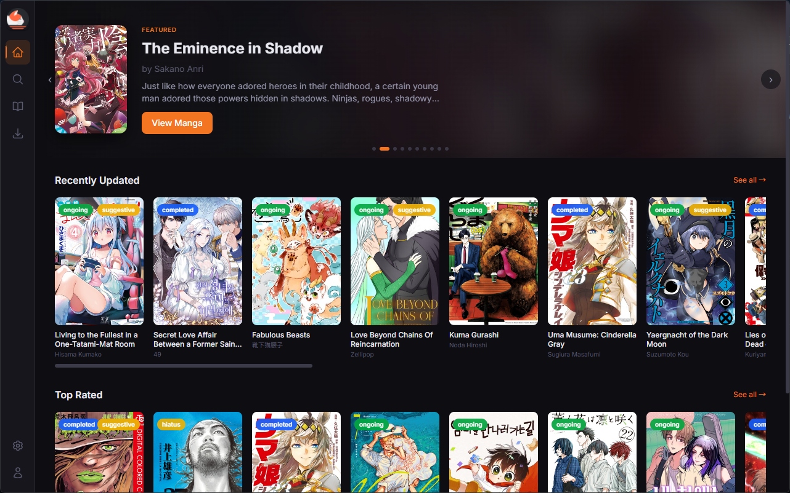
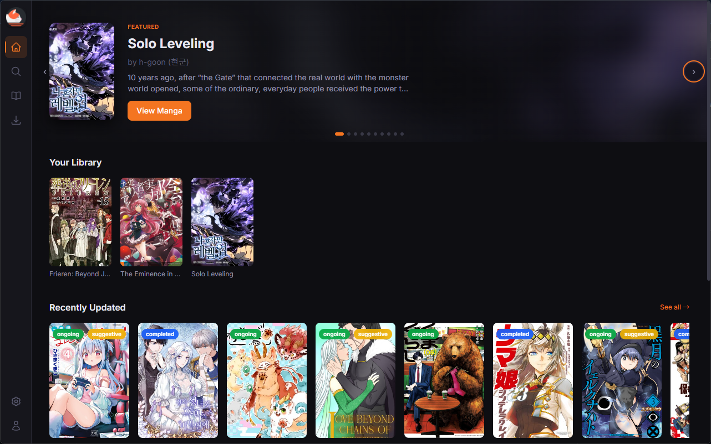
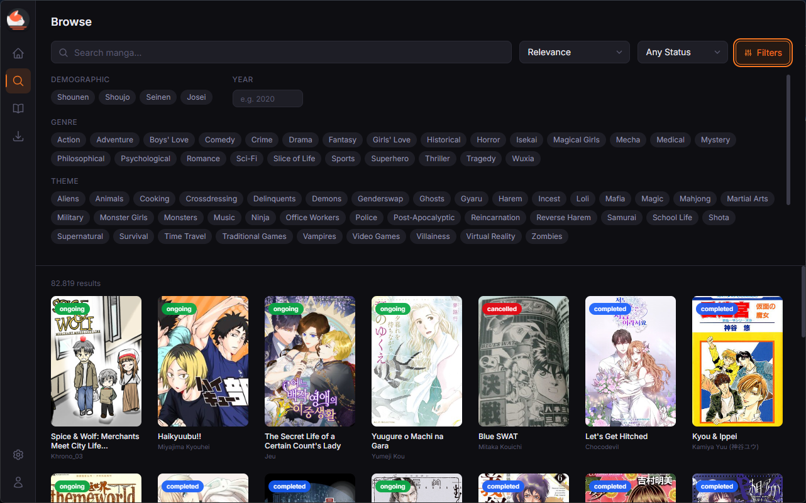
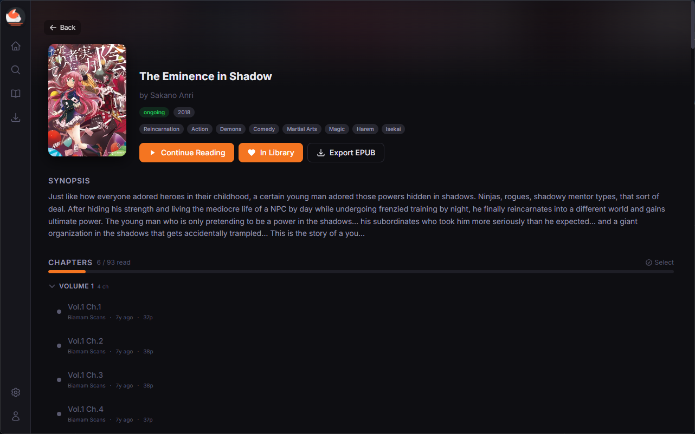
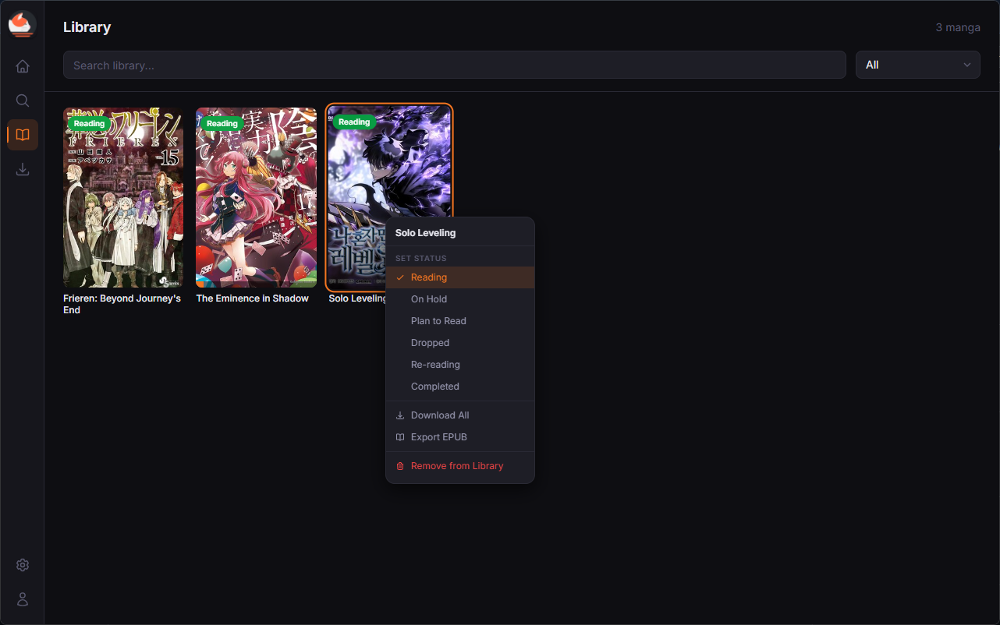
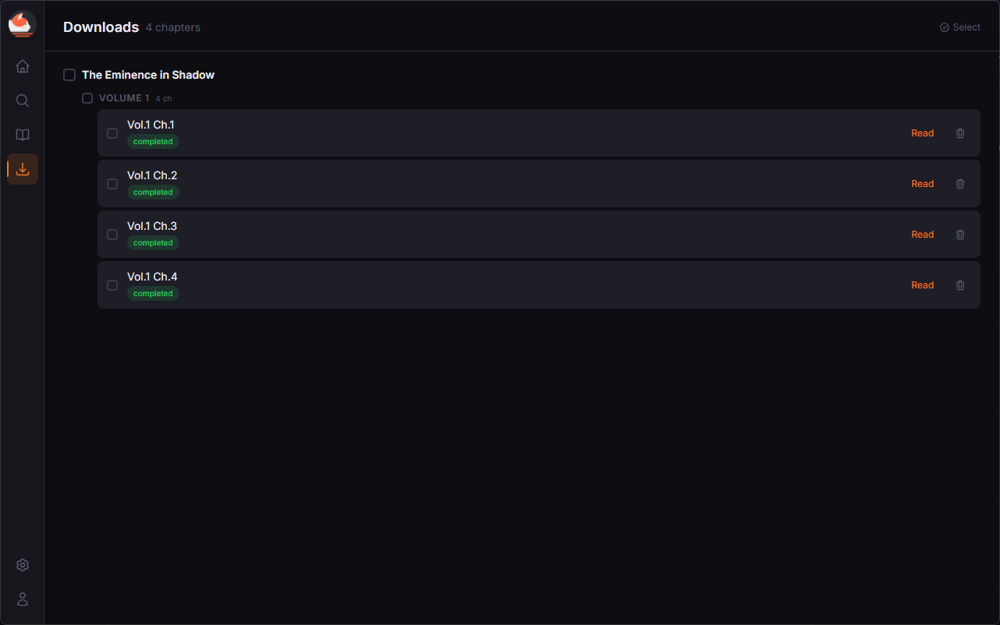
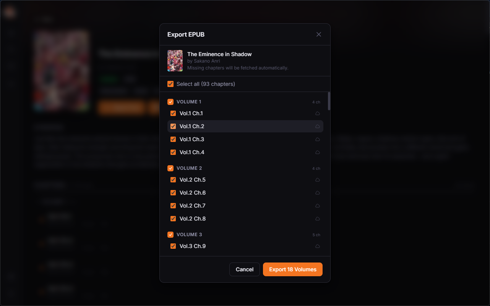

# MangaDex Desktop

A fast, native desktop app for browsing, reading, and downloading manga from MangaDex.

Built with **Tauri v2** (Rust), **Svelte 5**, and **TailwindCSS v4**.

[](https://github.com/Jackolix/mangadex-desktop-app/actions/workflows/build.yml)
[](https://github.com/Jackolix/mangadex-desktop-app/releases/latest)

---

## Screenshots

<p align="center">
  
  
</p>
<p align="center">
  
  
</p>
<p align="center">
  
  
</p>
<p align="center">
  
</p>

---

## Features

- **Home feed** — featured manga carousel, recently updated, and top-rated sections
- **Browse & search** — filter by demographic, genre, theme, status, and content rating
- **Manga detail page** — synopsis, chapter list, and one-click continue reading
- **Reader** — single-page, double-page, and long-strip modes; zoom to cursor with `Ctrl+Scroll`, pan by drag
- **Library** — bookmark manga and track reading status (Reading, Plan to Read, Completed, and more)
- **Downloads** — download chapters for offline reading, organized by volume
- **Export to EPUB** — export selected chapters or full volumes as an EPUB file
- **Reading progress** — automatically tracks progress so you can pick up where you left off
- **MangaDex account login** — sync your account via personal API client

---

## Tech Stack

| Layer | Technology |
|---|---|
| Frontend | Svelte 5 (runes), SvelteKit (SPA mode), TailwindCSS v4 |
| Backend | Tauri v2 (Rust) |
| Storage | SQLite via `tauri-plugin-sql`, `tauri-plugin-store` for settings & auth |
| API | MangaDex public REST API |

---

## Getting Started

### Prerequisites

- [Node.js](https://nodejs.org/)
- [pnpm](https://pnpm.io/)
- [Rust](https://www.rust-lang.org/tools/install)
- [Tauri CLI](https://tauri.app/start/prerequisites/)

### Development

```bash
pnpm install
pnpm tauri dev
```

### Build

```bash
pnpm tauri build
```

---

## MangaDex Login

Login requires a **personal API client**. To create one:

1. Go to [mangadex.org/settings](https://mangadex.org/settings) and open the **API Clients** section.
2. Create a new client and note your **Client ID** and **Client Secret**.
3. In the app, open **Settings** and enter your username, password, client ID, and client secret.

---

## Recommended IDE Setup

[VS Code](https://code.visualstudio.com/) with the following extensions:

- [Svelte for VS Code](https://marketplace.visualstudio.com/items?itemName=svelte.svelte-vscode)
- [Tauri](https://marketplace.visualstudio.com/items?itemName=tauri-apps.tauri-vscode)
- [rust-analyzer](https://marketplace.visualstudio.com/items?itemName=rust-lang.rust-analyzer)

---

## License

[MIT](LICENSE)
